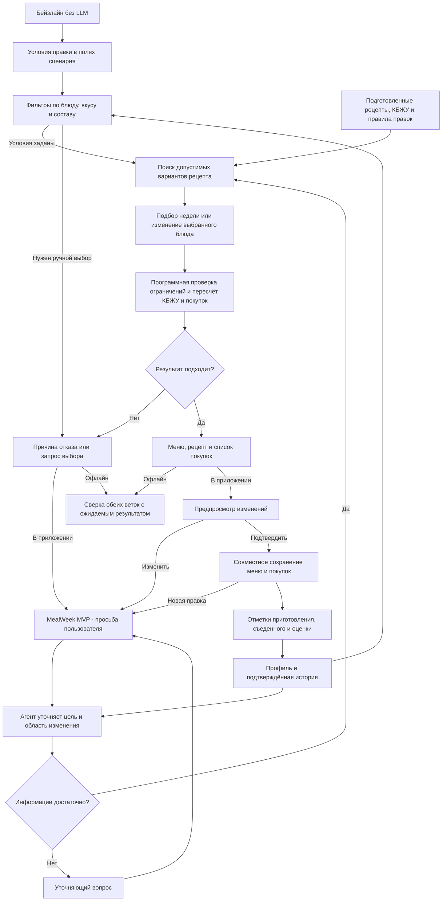

# ML System Design Doc - [RU]

## Дизайн ML системы - MealWeek: рацион на неделю · MVP · 1

**ДЗ №1–2 · Проектирование MVP и анализ данных · Версия 0.5 от 14 ноября 2026 года**

MealWeek — кроссплатформенное приложение для iOS и Android. ИИ-агент помогает составить меню на неделю по предпочтениям и целям КБЖУ пользователя, изменить выбранные рецепты и собрать список покупок. Рецепты берутся из заранее подготовленного каталога, а не генерируются языковой моделью.

*Шаблон ML System Design Doc от [Reliable ML](https://github.com/IrinaGoloshchapova/ml_system_design_doc_ru/blob/main/ML_System_Design_Doc_Template.md).*

Разделы 1.1–2.2 описывают продукт и архитектуру. В §2.3 результаты анализа данных и проверки двух правил подбора использованы для проектирования каталога, агента и недельного меню. Прототип приложения и пилот ещё предстоят. [Задание №1](https://gist.github.com/pacifikus/47424379293e0874859354ecd130ba13) · [Задание №2](https://gist.github.com/pacifikus/bada0e4b597852e4bb50512daf451929) · [Отчёт EDA](../reports/eda/README.md).

### 1. Цели и предпосылки

#### 1.1. Зачем идем в разработку продукта?

MealWeek нужен, чтобы подбирать рацион с учётом привычек человека и пересчитывать КБЖУ при каждой правке меню. Для такого подбора обычному чату с GPT нужно передать историю питания, предпочтения и данные о составе продуктов. В приложении цели, оценки блюд и подтверждённые замены сохраняются и учитываются при планировании следующей недели. При изменении порции или рецепта приложение пересчитывает КБЖУ по проверенному каталогу. Команда вручную собирает и проверяет данные, а по статистике оценок, замен и приготовлений решает, какие рецепты доработать.

**Для кого.** Для людей, которые следят за питанием, знают свои целевые калории и БЖУ, готовят дома и хотят тратить меньше времени на планирование.

При ручном планировании пользователь сам ищет рецепты, проверяет состав, распределяет блюда по дням и составляет список продуктов. Готовые планировщики уже берут часть этой работы на себя. Например, Eat This Much подбирает меню под цели питания и обновляет список покупок при замене блюд. [Возможности Eat This Much](https://www.eatthismuch.com/)

На российском рынке «Рацион» подбирает недельное меню с учётом КБЖУ, а «Юменю» помогает составить меню из рецептов и собрать список покупок. [Рацион](https://racion.app/) · [Юменю](https://ymenu.ru/)

**Польза продукта** — готовый недельный план и согласованный список покупок, которые можно быстро изменить. Бизнес-цель — сократить время планирования и дать повод возвращаться каждую неделю. Возможная модель заработка — подписка; готовность платить ещё нужно проверить.

**Зачем нужен агент.** Увеличить число порций удобно кнопкой. С просьбой «хочу эту кашу чуть слаще, но без добавленного сахара» пользователь знает желаемый вкус, а выбор ингредиента и количества готов поручить системе. Агент учитывает, о каком блюде идёт речь, и предлагает подходящую правку из проверенных вариантов этого рецепта. Пользователь видит, что именно изменится, и решает, принять ли предложение.

**Критерий пользы.** Цель двухнедельного пилота — медианная экономия времени на подготовку недельного меню и списка покупок не менее **20%** относительно привычного способа каждого участника. Время включает подбор и правки. Отдельно сравним качество меню и выполнение просьб о вкусе с программным подбором без LLM (§2.1).

#### 1.2. Бизнес-требования и ограничения

##### Как пользователь работает с приложением

1. **Рассказывает агенту о целях.** В диалоге задаёт дневные калории и БЖУ, количество приёмов пищи, исключённые продукты, предпочтения, оборудование и время готовки. Агент уточняет недостающее и предлагает подтвердить профиль.
2. **Получает черновик недели.** Основной экран — меню по дням с порциями и дневными КБЖУ. Из него открываются карточки с ингредиентами и шагами приготовления. Чат дополняет этот экран, а не заменяет его.
3. **Меняет и подтверждает план.** Можно выбрать альтернативное блюдо, убрать или заменить ингредиент, изменить пропорции и порции. Перед сохранением видны новый рецепт, дневные КБЖУ и изменения покупок. Остальные блюда сохраняются. Частые действия доступны кнопками, сложные просьбы — в диалоге.
4. **Пользуется покупками и рецептами.** После подтверждения получает единый список продуктов по категориям. Совместимые ингредиенты объединяются, количества суммируются. Отметки купленного сохраняются после правок; видно, что докупить и что стало лишним.
5. **Оставляет обратную связь.** Можно добавить блюдо в избранное, оценить его, отдельно отметить приготовленное и съеденное. Эти сведения помогают следующему подбору.

КБЖУ проверяются для каждого дня, а не только в среднем за неделю. Начальный вариант допусков — ±5% по калориям и ±10% по каждому из БЖУ. Пользователь подтверждает их до подбора.

##### Основные ограничения

- **Данные.** Для подбора нужна база продуктов и конкретных товаров с полными данными о калорийности, белках, жирах и углеводах. Команда собирает эти сведения и обновляет их при изменении состава товара. Больше всего ручной работы требует каталог рецептов. Для каждого блюда нужно проверить ингредиенты, их вес, выход готового блюда, размер порции и допустимые замены.
- Приложение не назначает КБЖУ и лечебные диеты, не обещает похудение или медицинскую безопасность. Фильтрация ингредиентов также не гарантирует отсутствие следов аллергенов в купленном продукте.
- Редактировать рецепт можно в пределах заранее проверенных вариантов. Если изменение требует нового способа приготовления, агент предлагает допустимую замену или другое блюдо, а не сочиняет инструкцию.
- В первой версии поддерживается лимит общего времени приготовления одного блюда. Просьба «не больше получаса» требует уточнения, если непонятно, идёт ли речь об активной работе или общем времени, об одном блюде или всём дне.
- При нехватке данных или несовместимых условиях агент объясняет проблему и запрашивает решение пользователя. Он не меняет цели и запреты самостоятельно.
- Агент работает только с данными текущего пользователя и не совершает покупок. Историю можно исправить или удалить. Перед использованием внешней модели потребуется согласовать передачу и хранение данных; персональные данные для подбора не нужны.

##### Как пройдёт пилот

В ДЗ №1 проектируем решение (§1.3). После появления прототипа пригласим **8 человек**, которые готовят дома и уже задают себе цели КБЖУ. За **2 недели** каждый составит два меню на семь дней с одинаковыми личными ограничениями. Случайно выберем четверых, которые начнут с MealWeek и на второй неделе вернутся к привычному способу. Остальные пройдут этапы в обратном порядке. В обоих случаях участник внесёт хотя бы одну желаемую правку и подготовит список покупок. Меню первой недели во вторую не копируем.

Замеряем время от начала планирования до момента, когда участник готов пользоваться меню и списком покупок. В MealWeek в замер входят ввод профиля, уточнения, правки и подтверждение. Для каждого участника считаем экономию как `(обычное время − время с MealWeek) / обычное время`, затем берём медиану по участникам. Незавершённые задания фиксируем отдельно.

- **Расширяем пилот**, если все восемь участников завершили оба задания, медианная экономия достигла 20% и все подтверждённые меню прошли обязательные проверки из §2.1.
- **Дорабатываем**, если участники бросают подбор или экономия ниже цели. По ходу сессий выясняем, куда уходит время, исправляем этот шаг и повторяем пилот. Если после доработки медианная экономия остаётся нулевой или отрицательной, прекращаем развивать этот способ планирования.
- **Сразу приостанавливаем пилот**, если в подтверждённом меню нашли запрещённый ингредиент или другое нарушение обязательного ограничения. Возобновляем после исправления и проверки сценария, на котором возникла ошибка.

**Стоимость.** Для ориентира возьмём Claude Haiku 4.5 и суммарно 10 000 входных и 2 000 выходных токенов на подбор недели, уточнения и правки. При стандартных ценах $1 и $5 за миллион соответственно это **$0,02 за меню**. В пилоте разделим стоимость всех вызовов агента, включая повторы и незавершённые сессии, на число подтверждённых недельных меню. Расходы на офлайн-оценку LLM-судьёй учтём отдельно. [Тарифы Anthropic на 5 ноября 2026 года](https://platform.claude.com/docs/en/about-claude/pricing)

#### 1.3. Что входит в скоуп проекта/итерации, что не входит

**В ДЗ №1:** этот дизайн-документ, README, настройки Ruff и pre-commit, воспроизводимые команды проверки репозитория. Реализация мобильного клиента, backend, сбор каталога и проведение экспериментов относятся к следующим этапам.

**В проектируемый MVP:** русский язык, меню на семь дней. Дневные цели КБЖУ одинаковы на протяжении недели. Включены диалоговое заполнение профиля, недельный экран, подбор из каталога, допустимые правки рецептов, покупки, избранное и пользовательские отметки. Клиент будет общим для iOS и Android; предварительно рассматривается [Flutter](https://docs.flutter.dev/reference/supported-platforms).

**Не входят в MVP:** медицинские назначения, семейные профили с разными целями, произвольное создание рецептов, распознавание еды по фото, голосовой интерфейс, интеграции с магазинами и трекерами здоровья, цены и заказ продуктов. Также откладываются учёт домашних запасов, перенос остатков одной готовки между днями, оптимизация общего времени готовки за день и полноценный дневник еды вне каталога.

Для повторения экспериментов будем сохранять версии каталога, правил расчёта, модели, её настроек и проверочных сценариев. Личные данные не попадут в публичный репозиторий. Масштабирование, работа без сети и инфраструктура промышленного сервиса — задачи после проверки MVP, а не обязательная часть первого ДЗ.

#### 1.4. Предпосылки решения

План строится на **семь дней** с выбранным количеством приёмов пищи. Подбираются блюда и порции, цели проверяются по дням. Пользователь готовит по рецептам из заранее собранного каталога;

##### Какие данные нужны

| Данные | Содержание и способ получения |
| --- | --- |
| Каталог рецептов | Планируем собрать 60–100 рецептов из собственной подборки или источников с разрешённым использованием. В карточке храним ингредиенты, количества, порции, шаги, время и оборудование. Для каждого варианта вручную проверяем, можно ли приготовить блюдо по обновлённой инструкции, и отмечаем, как изменится вкус. |
| Справочник продуктов | Названия и синонимы, единицы, состояние продукта, КБЖУ и источник значений. Полноту КБЖУ в выпуске FNDDS проверили в §2.3. Соответствие привычным для российских пользователей продуктам ещё предстоит проверить. Рассматриваем [USDA FoodData Central](https://fdc.nal.usda.gov/data-documentation/), [базу продуктов и блюд ФИЦ питания и биотехнологии](https://ion.ru/nauka/baza-dannykh-khimicheskogo-sostava/1-1-baza-dannykh/1.1_baza%20dannih.html) и [таблицы состава и калорийности российских продуктов Скурихина и Тутельяна](https://rusneb.ru/catalog/000199_000009_003081420/). |
| Профиль и история | Пользовательские цели, ограничения, оценки, отметки о приготовленном и съеденном. Реальных данных пока нет; первые сценарии для разработки будут подготовлены самостоятельно. |
| Проверочные примеры | Профили, запросы на изменения и ожидаемые ограничения результата. Расчёты и допустимость изменений проверяются независимо от ответов агента. |

**Единицы и порции.** Нельзя смешивать сырой и готовый вес, значения на 100 г и на порцию. Для ингредиентов заранее задаются единицы и правила пересчёта; для готового блюда — выход и состав порции. Значения остаются расчётной оценкой, а не измерением конкретного обеда. Цель и справочник должны одинаково трактовать углеводы: в первой версии учитываются общие углеводы, включая клетчатку, что объясняется при вводе.

Количество приготовленного и съеденного различается. Например, если готовятся четыре порции, а пользователь планирует съесть одну, покупки рассчитываются на четыре, его дневные КБЖУ — на одну. Остальные порции не записываются автоматически как еда на следующий день.

##### Главные риски

- **Каталога не хватает под заданные условия.** До пилота проверим покрытие типичных профилей. При частых отказах расширим подборку или явно сузим поддерживаемые варианты питания.
- **Правка делает рецепт неприготовимым.** Проверяются не только отдельные замены, но и их сочетания, количества и соответствующие шаги приготовления.
- **Ошибка в расчёте или понимании запроса.** Нужны независимые примеры расчётов и подтверждение изменений. Правильно посчитанные калории сами по себе не доказывают правильность рецепта.

### 2. Методология `Data Scientist`

#### 2.1. Постановка задачи

MealWeek — **рекомендательная система с диалоговым LLM-агентом и программным подбором меню под ограничения**. Для MVP планируется один агент с ограниченными инструментами.

**Вход:** цели КБЖУ, подтверждённые ограничения и предпочтения, каталог, доступная история и текущая просьба пользователя. **Выход:** подходящее меню на семь дней, готовые карточки рецептов и список продуктов либо понятное объяснение, почему подбор пока не завершён.

##### Бейзлайн и сравнение с агентом

Бейзлайн — программа без LLM. Она фильтрует рецепты и их варианты по заданным полям, затем подбирает блюда и порции под дневные КБЖУ. Для правки можно указать блюдо, желаемый вкус, исключения или конкретную замену. Например, по полю «острее» программа ищет варианты с такой отметкой. Если заданных полей недостаточно, она запрашивает ручной выбор. Для офлайн-проверки поля задаются в тестовом сценарии.

Оба варианта получают одинаковые профиль, историю, исходное меню, каталог и лимиты. Агенту передаём просьбу обычными словами, бейзлайну — только явно названные в ней условия в виде полей. Ингредиент и количество, которые предстоит подобрать, в исходные данные не подставляем. Для простых замен и для составных просьб о вкусе отдельно сравним долю выполненных правок и долю случаев, когда человеку пришлось самому выбрать ингредиент или дозировку. Допускаем несколько правильных вариантов. Проверяем вкус по заранее размеченным вариантам рецепта, соблюдение запретов и область правки. Для обеих систем действуют одни и те же проверки КБЖУ, покупок и качества меню.

##### Что делает агент

- **LLM-агент** выбирает следующий шаг: уточнить запрос, прочитать профиль и историю, вызвать поиск, подбор или пересчёт. Например, отличает правку одного блюда от изменения предпочтений на будущее. Параметры инструментов и доступ к данным проверяет backend.
- **Поиск рецептов** использует смысл запроса и явные предпочтения. При ранжировании учитываются избранное, оценки и недавние повторы; предпочтения не отменяют строгих запретов. Пока истории нет, достаточно заполненного профиля. Для первой версии планируется готовая модель без собственного дообучения.
- **Подбор меню** выбирает сочетание допустимых блюд и порций под дневные КБЖУ. Сначала соблюдаются строгие ограничения, затем учитываются вкус и разнообразие. Проверяется итоговый вариант рецепта: блюдо с необязательным луком может подойти после заранее разрешённого удаления лука.
- **Расчётный компонент** проверяет количества, считает КБЖУ и объединяет ингредиенты в покупки. Карточки, инструкции и числа приложение показывает из этих данных, а не переписывает из свободного ответа LLM.

Если среди первых найденных рецептов нет сочетания, поиск расширяется до остального допустимого каталога. Истечение времени поиска не означает, что подходящего меню не существует. Пользователь должен различать нехватку ввода, отсутствие сочетания в каталоге и технический сбой. Длительность и число обращений агента к модели ограничиваются. При сбое текущий план сохраняется; агент сообщает о проблеме и предлагает повторить запрос позже.

##### Как меняется рецепт

Исходный рецепт остаётся неизменным. Для пользователя создаётся личный вариант по подготовленным правилам, затем пересчитываются день и покупки. Backend сохраняет их совместно только после подтверждения пользователя; слова агента о сохранении не заменяют выполненную операцию.

| Просьба | Поведение системы |
| --- | --- |
| «Сделай сегодняшнюю овсянку чуть слаще, без добавленного сахара» | Для тестового рецепта с бананом подготовим более сладкий вариант с 60 г банана вместо 40 г на порцию. Если он подходит под ограничения, агент покажет замену и пересчёт. Правка относится только к этому завтраку. |
| «Добавь остроты томатному супу в четверг, но без чеснока» | Агент проверит состав приправ и предложит вариант с хлопьями чили, если он предусмотрен для супа. В предпросмотре будут количество на порцию и шаг, на котором их добавить. Другие ужины и предпочтения профиля сохраняются. |
| «Больше овощей, меньше крупы» | Уточняет количества или предлагает разрешённый вариант пропорций; пересчитывает КБЖУ. |
| «Сделай четыре порции вместо двух» | Меняет объём приготовления в допустимых пределах; отдельно уточняет, сколько пользователь собирается съесть. |

В §2.3 вариант овсянки проверен на уровне состава и расчёта КБЖУ. Варианты для пилота ещё требуют кулинарной проверки. Если допустимой правки нет, предлагается другое блюдо. Если изменённый рецепт не укладывается в дневные цели, пользователь выбирает альтернативу или явно разрешает пересмотреть другие ещё не приготовленные блюда этого дня. Уже начатую или завершённую готовку нельзя изменить задним числом. Купленное количество продуктов сохраняется: при росте потребности приложение показывает, сколько докупить.

История хранит то, что пользователь действительно отметил, с количеством порций и временем. Отсутствие записи не означает, что человек ничего не ел; по неполной истории нельзя делать вывод о всём фактическом рационе. Оценки и отказы помогают уточнять предпочтения, но не меняют цели КБЖУ автоматически.

##### Как оцениваем качество подбора

**LLM-as-a-Judge** оценивает, насколько подобранное меню подходит конкретному пользователю. Отдельная модель получает запрос и подтверждённый профиль, доступную на момент подбора историю, выбранные рецепты с порциями, недельный план и результаты программных проверок. При редактировании передаются также исходное меню и просьба об изменении.

| Критерий | Что оцениваем в подборке |
| --- | --- |
| Соответствие предпочтениям | Выбранные блюда соответствуют указанным вкусам, желаемым типам блюд и стилю питания. |
| Разнообразие | Нет нежелательных повторов блюд и основных ингредиентов; просьба пользователя повторять любимые блюда учитывается, а не штрафуется. |
| Учёт истории | Подбор учитывает оценки и недавние блюда. При отсутствии истории опирается на профиль, не выдумывая прошлые предпочтения. |
| Практичность | Сложность выбранных рецептов соответствует условиям и пожеланиям пользователя, например просьбе готовить простые блюда без сложной подготовки. |
| Соответствие корректировкам | Обновлённая подборка выполняет просьбу пользователя и сохраняет не затронутые ею части меню. Этот критерий применяется только к сценариям редактирования. |

По каждому применимому критерию: **0 — не выполнен, 1 — выполнен частично, 2 — выполнен полностью**. Судья кратко обосновывает балл конкретными блюдами и сведениями из запроса или профиля. Неприменимый критерий не входит в итог: сумма баллов делится на максимально возможную по применимым критериям. При нехватке данных оценка не засчитывается как успешная.

Предварительный ориентир — не менее 80% сценариев с заранее проверенной возможностью подбора получают не менее 80% возможных баллов без нулей по применимым критериям. Ошибки подбора и отсутствие оценки не исключаются из этого числа сценариев. Это цель будущей проверки, не полученный результат.

**Программно** отдельно проверяются дневные КБЖУ, запрещённые ингредиенты, время и оборудование, допустимость вариантов рецептов, список покупок и фактически сохранённые изменения. Эталонные расчёты готовятся независимо от проверяемого компонента. Меню с нарушением обязательного условия не проходит проверку независимо от оценки судьи.

До итогового теста сверим оценки судьи с независимой человеческой разметкой подборок, уточним рубрику и зафиксируем модель и промпт. Примеры для настройки отделим от итоговых; вариации одного сценария держим вместе. Проверим обычный подбор, разные предпочтения, правки, отсутствие истории и несовместимые условия. Сценарии с заранее независимо проверенной несовместимостью условий учитываются отдельно: в них проверяется корректность отказа, а не качество несуществующего меню. Неудача агента сама по себе не делает сценарий неразрешимым.

#### 2.2. Блок-схема решения

##### Бейзлайн и диалоговый MVP

У двух вариантов общий каталог, подборщик и калькулятор. В офлайн-сравнении проверяем результат обеих веток. В приложении пользователь также видит предпросмотр и подтверждает сохранение.

#### 2.3. Этапы решения задачи

##### Этап 1. Подготовка данных

**Вход.** Для расчёта нужна версия продукта с КБЖУ на 100 г, для подбора — версия рецепта с разрешёнными изменениями, для персонализации — только сведения, известные до запроса. Бейзлайн и агент используют один снимок каталога. Ниже приведены фактическое состояние данных и порядок подготовки пилота. [Исходные данные, графики и результаты EDA](../reports/eda/README.md).

| Входные данные и ключ | Что доступно сейчас | Как получаем и обновляем |
| --- | --- | --- |
| Продукт, состояние и единица измерения | В USDA FNDDS 2021–2023 есть 5 432 позиции. Все четыре КБЖУ заполнены у 5 431. У 37 позиций нет положительной массы с явно названной порцией по правилу EDA. Это данные американского обследования питания. | Инженер загружает ZIP с CSV при выходе новой редакции, сохраняет версию и контрольную сумму. Внутренний ID связывает продукт с ID источника, состоянием, граммовкой и единицей нутриента. Для российского пилота редактор сверяет состав по этикеткам и разрешённым источникам из §1.4. Изменение состава товара создаёт новую версию. |
| Рецепт и вариант, связанные с версиями ингредиентов | 4 учебные карточки и 10 изменений вкуса. Для пилота проверенных рецептов пока 0. У всех 18 584 строк состава FNDDS отсутствует прямая ссылка на FDC ID ингредиента. | Редактор вносит в карточку веса, сырой или готовый продукт, выход, порции, время, оборудование, шаги и пределы изменения. Второй человек проверяет источник, готовит вариант и подтверждает инструкцию и метку вкуса. После правки карточка проходит проверку повторно. |
| Профиль, запрос, состояние недели и история на момент запроса | Для EDA есть 18 придуманных просьб о правке. Историй питания реальных пользователей нет. | Для формы сохраняем только явно заданные поля, для агента — текст и то же состояние. В пилоте события приготовления, оценки и съеденные порции поступают после действия пользователя с его согласием. У события есть время и версия меню. При холодном старте используем подтверждённые поля профиля. |

**Целевые данные для оценки.** Их храним отдельно от входа модели. Для разметки недели целевой объект — весь результат подбора, для правки — состояние выбранного блюда и затронутого дня после действия.

| Единица разметки | Что считаем правильным ответом | Как проверяем |
| --- | --- | --- |
| Один запрос | Одно или несколько допустимых действий и вариантов, запрос недостающего поля либо обоснованное отсутствие варианта | Разметчик фиксирует допустимые варианты, область правки и обязательные запреты до прогона. Второй размечает закрытый тест независимо. Расхождения разбирают по карточкам, спорные случаи уточняют до фиксации теста. |
| Сценарий недели | Существует хотя бы одна допустимая неделя, доказана несовместимость либо необходимы дополнительные сведения. Для допустимой недели оценивается качество подбора по §2.1. | Для разрешимых сценариев сохраняем пример допустимого плана и независимый пересчёт. Для отказов указываем конфликт или результат полного перебора допустимых вариантов. В тесте принимаются и другие корректные планы. |

**Каких данных не хватает.** До пилота нужно подготовить 60–100 проверенных рецептов и сопоставить с российским справочником каждый их ингредиент. Начинаем с 60. Для каждого поддерживаемого профиля пробуем собрать семь дней с заданным числом приёмов пищи. Новые карточки до верхней границы добавляем в те группы, где не хватает вариантов. Отдельно проверяем хотя бы одну правку вкуса у каждого блюда, которому в интерфейсе обещано редактирование вкуса. Записи без полного КБЖУ или надёжного перевода в граммы остаются вне подбора.

План для офлайн-оценки — собрать **ещё 90 самостоятельных семейств сценариев**: 30 для разработки, 30 для валидации и 30 для однократного закрытого теста. В каждом наборе планируем по 10 семейств на подбор недели, правки и ситуации с уточнением или отказом. Внутри семейства можно менять формулировку и повторять запуск. Так у каждого типа есть отдельный знаменатель для разбора ошибок. Имеющиеся 18 примеров остаются открытыми примерами разработки. Эти объёмы подходят для первой диагностики, но вывод о времени планирования потребует наблюдений в пилоте.

**Конфиденциальность.** В материалах ДЗ только открытые справочные данные и вымышленные запросы. В пилоте цели питания, ограничения и журнал еды привязаны к человеку. Храним их под внутренним ID с разграничением доступа. Для оценки отбираем минимально нужные поля с согласия участника и удаляем идентификаторы и свободный текст с личными сведениями. Во внешнюю модель передаём только согласованный контекст текущего пользователя. В репозиторий идут вымышленные примеры и агрегаты. Участник может удалить историю.

**Выход этапа.** Для ДЗ получены закреплённый снимок, диагностика качества и размеченные учебные правки. Для начала сравнения систем нужны версионированный каталог с проверенными карточками, список исключённых записей с причинами, отдельные входы и эталоны и зафиксированное разбиение семейств.

##### Этап 2. Подготовка прогнозных моделей

**Что сравниваем.** Одно наблюдение — запрос на неделю либо правку вместе с доступным на этот момент состоянием. После каждого подтверждённого изменения пересчитываем затронутый день и покупки, горизонт полного подбора — семь дней.

| | Бейзлайн без LLM | Диалоговый MVP |
| --- | --- | --- |
| Предобработка | Названия и синонимы приводим к ID. Веса преобразуем в граммы, цели и запреты задаются отдельными полями. Условия из тестовой фразы вручную переносятся в форму без подсказки верного ответа. | Агент получает ту же информацию и исходную просьбу на русском. Готовая языковая модель формирует типизированный вызов с блюдом, областью правки, желаемым вкусом, запретами и предпочтениями либо задаёт уточняющий вопрос. Backend проверяет схему и доступ. |
| Поиск и выбор | Фильтруем по итоговому составу и обязательным полям. Из оставшихся вариантов первыми идут удовлетворяющие мягким предпочтениям, затем требующие меньшего изменения граммов. При равенстве порядок задаёт ID. Для недели используется общий подборщик этапа 3. | На том же допустимом каталоге сравним простой поиск по полям со смысловым поиском по запросу и описаниям карточек. Кандидатов ранжируем с учётом явных предпочтений, прошлых оценок и недавних повторов. Готовая модель вызывает общий подборщик и калькулятор. |
| Отправная точка | На 18 учебных правках правило минимального изменения веса дало 15 совпадений. Добавление явных предпочтений дало 18/18. Этот второй вариант берём для дальнейшего сравнения. | Агент ещё не прогонялся. Проверяем, уменьшает ли диалог ручной выбор и число действий пользователя при сопоставимом качестве недели. Выигрыш агента по этим 18 примерам установить нельзя. |

**Метрики и функции потерь.**

- Для правки используем потерю 0/1. Потеря равна 0, если действие и выбранный вариант входят в размеченное множество, обязательные ограничения и область правки соблюдены. Иначе потеря равна 1. Средняя потеря по запросам показывает долю ошибок. Отдельно считаем успех на выполнимых правках, долю корректных отказов и долю корректных уточнений. Запрос ручного выбора учитываем отдельно, поскольку он занимает время пользователя.
- Для поиска считаем **Hit@k** на разрешимых запросах с размеченными вариантами: попал ли хотя бы один подходящий вариант в первые k. Допустимых замен может быть несколько. Пропуск на поиске лишает подборщик возможности выбрать любую из них. Для проверки смыслового поиска меняем k на валидации между 3, 5 и 10, сравниваем полноту попаданий, задержку и поведение при расширении поиска на весь каталог.
- Для готовой недели применяем рубрику §2.1. Знаменатель — все заранее признанные разрешимыми сценарии. Успешный сценарий проходит каждую программную проверку, достигает 80% возможного балла судьи и не получает нулей. Цель — не менее 80% таких сценариев. Отдельно публикуем число жёстких нарушений и число ложных отказов. На закрытом тесте любое подтверждённое нарушение блокирует пилот.
- В этой итерации используются готовые веса модели. Обучающей функции потерь для LLM здесь нет. Настройки поиска и промпта выбираем по средней потере 0/1 при соблюдении жёстких проверок. Если в пилоте накопятся подтверждённые пары «предпочтённый вариант — отклонённый вариант» из одного показа, для обучаемого ранжировщика проверим попарную логистическую потерю `log(1 + exp(s_отклонённого − s_предпочтённого))`. Она штрафует обратный порядок вариантов. Пропущенный показ и отсутствие отметки о еде не считаем отрицательной меткой.

**Валидация и выбор конфигурации.** Одни и те же исходные меню, версии каталога, профили и лимиты используем в обеих ветках. Семейство включает исходную ситуацию, её перефразы и близкие варианты. Семейства и варианты одного исходного тестового профиля не делим между выборками. При появлении реальных событий фиксируем момент запроса: оценки из будущего недоступны. Холодный старт и сценарии с историей показываем раздельно. Закрытые запросы, эталоны и решения не попадают в инструкции агента, примеры и поисковый индекс.

На разработке сравним признаки «предпочтение заявлено», «уже есть в рецепте», «недавно повторялось», а также варианты поиска и промпта. На валидации выберем k, веса предпочтений и модель по качеству, времени ответа и фактической стоимости. Из конфигураций, прошедших обязательные проверки и порог качества, предпочтём более дешёвую при сопоставимой задержке. Для финального сравнения зафиксируем версии модели, промпта, инструментов и каталога. Каждую задачу прогоним обеими ветками, агентом — трижды для оценки нестабильности. Публикуем парные разницы по семействам, диапазон результатов повторов и число семейств в каждом срезе. При оценке неопределённости повторно выбираем целые семейства, сохраняя все их перефразы и запуски вместе.

**Интерпретация и риски.** Для расхождений сохраняем разобранный запрос, список вариантов до и после фильтрации, выбранный вариант и причину отказа. Так различаем потерю пожелания, отсутствие блюда в каталоге, ошибку поиска и ошибку расчёта. Если варианты правильно найдены, но неделя не собрана, разбираем подборщик отдельно. Человеческий эксперт проверяет случайные успешные ответы и все нарушения обязательных условий. Срезы включают запреты, мягкие предпочтения, составные просьбы, холодный старт и нехватку данных.

**Выход этапа.** Парный отчёт по закрытому тесту с примерами ошибок, качеством правок и недель, долей ручного выбора, p95 времени ответа и стоимостью всех вызовов на подтверждённое меню. При нуле подтверждённых меню публикуем суммарные расходы и число неудач. Если агент не упрощает действия пользователя при том же качестве, сохраняем форму с более сильным правилом и разбираем, где диалог добавляет лишние шаги.

##### Этап 3. Подбор недели и пересчёт покупок

Обе ветки передают подтверждённые ограничения в один программный подборщик. Для каждого приёма пищи он перебирает проверенные варианты блюда и разрешённые размеры порций. Исключает запрещённые ингредиенты, неподходящее оборудование и превышение времени готовки. Для каждого дня сумма съедаемых порций должна укладываться в согласованные допуски (§1.2). Среди допустимых планов последовательно минимизируем число неудовлетворённых мягких предпочтений, нежелательных повторов и суммарное относительное отклонение от дневных целей. Явная просьба повторить блюдо снимает соответствующий штраф. Так допустимость дня не зависит от весов ранжирования.

Для малых учебных каталогов эталон — полный перебор. На каталоге пилота используем дискретную оптимизацию по слотам недели. Начинаем с первых k кандидатов и расширяем набор при необходимости. При исчерпании лимита времени возвращаем отдельный технический исход. Отказ из-за конфликта допустим, только если перебраны все варианты или решатель доказал несовместимость. Для обоих интерфейсов решение содержит версии рецептов, граммы ингредиентов и порции по дням.

КБЖУ умножаются на съедаемые порции, покупки — на приготовляемые. В учебном примере дополнительные 20 г банана на порцию дают +19,4 ккал в день для одной съедаемой порции и +80 г в закупку при готовке четырёх. В трёх проверенных дневных контекстах одна и та же правка прошла проверки один раз, во втором дне превысила лимит энергии, в третьем — только углеводов. При уже купленном товаре показываем только недостающее количество. Проверяем границы допусков каждого дня до округления, изменение одного дня, разные единицы и отсутствие изменений в остальных шести днях. Эталонные суммы готовим отдельно от кода подборщика.

**Выход этапа.** Неделя или обоснованный исход подбора, дневная разбивка КБЖУ, агрегированный список покупок и протокол независимой сверки для обеих веток. Ошибка любого обязательного расчёта исключает план из выдачи.

##### Этап 4. Подтверждение правки и проверка перед пилотом

Бейзлайн получает заполненную форму, агент — свободный запрос. Оба создают один тип черновика с исходной версией недели, выбранным блюдом, изменением состава, шагов рецепта, дневных КБЖУ и покупок. До подтверждения показываем разницу пользователю. Отмена оставляет прежнюю неделю. Подтверждение записывает меню и покупки вместе. Повтор того же запроса на сохранение возвращает прежний результат по ключу операции. Если меню изменилось в другом сеансе, строим новый предпросмотр. Уже приготовленное блюдо заблокировано для редактирования.

Проверяем три свойства на уровне состояния: отмена ничего не записывает, повтор не удваивает покупку, сбой между обновлениями не оставляет меню и покупки разных версий. Для обеих веток проверяем и неудобные исходы — необходимость самому выбрать ингредиент, лишний уточняющий вопрос и повторную попытку после тайм-аута. На каждый сценарий фиксируем исход, число действий и длительность. Для агента добавляем число вызовов модели, токены и расходы с повторами.

Для оценки вкусовых предпочтений и практичности меню отдельный LLM-судья получает результаты обеих систем под скрытыми обозначениями. При парном сравнении меняем порядок ответов. На валидации два человека независимо оценивают подборки по рубрике §2.1, затем согласуют спорные случаи. Сравниваем их итог с судьёй и отдельно считаем ложные зачёты. Если судья систематически пропускает ошибку, уточняем рубрику на валидации и повторяем калибровку. На закрытом тесте рубрику не меняем. Программные запреты имеют приоритет над любым баллом.

**Выход этапа.** Решение о запуске пилота на основании закрытого теста, списка дефектов и проверки сохранения. Для допуска требуются достигнутая цель качества из §2.1 и отсутствие нарушений обязательных условий и ошибок сохранения. После допуска запускаем пилот §1.2: 8 участников, две недели, сравнение с привычным способом. Решение о расширении принимаем по завершению заданий и медианной экономии времени не менее 20%.
