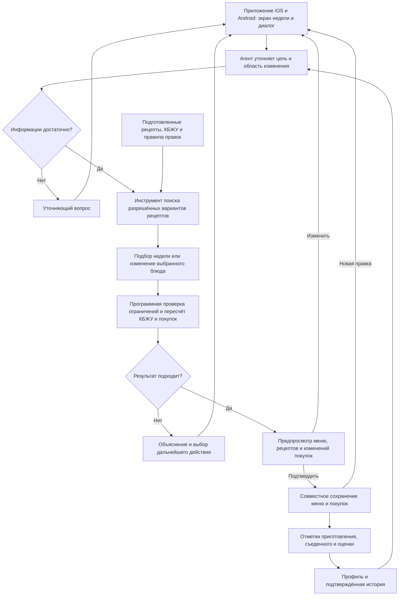

# ML System Design Doc - [RU]

## Дизайн ML системы - MealWeek: рацион на неделю · MVP · 1

**ДЗ №1 · Проектирование MVP · Версия 0.1 от 29 октября 2026 года**

MealWeek — кроссплатформенное приложение для iOS и Android. ИИ-агент помогает составить меню на неделю по предпочтениям и целям КБЖУ пользователя, изменить выбранные рецепты и собрать список покупок. Рецепты берутся из заранее подготовленного каталога, а не генерируются языковой моделью.

*Шаблон ML System Design Doc от [Reliable ML](https://github.com/IrinaGoloshchapova/ml_system_design_doc_ru/blob/main/ML_System_Design_Doc_Template.md).*

По [заданию ДЗ №1](https://gist.github.com/pacifikus/47424379293e0874859354ecd130ba13) заполнены разделы 1.1–1.4 и 2.1–2.2. Приложение, каталог и эксперименты ещё не реализованы. Численные цели — предварительные ориентиры, а не полученные результаты.

### 1. Цели и предпосылки

#### 1.1. Зачем идем в разработку продукта?

**Для кого.** Для людей, которые следят за питанием, знают свои целевые калории и БЖУ, готовят дома и хотят тратить меньше времени на планирование.

Сейчас пользователю приходится отдельно искать рецепты, проверять состав, считать порции, распределять блюда по дням и составлять список продуктов. Если блюдо не подходит, часть работы нужно повторить. Предположение о том, что это заметная проблема, проверим на интервью с будущими пользователями.

**Польза продукта** — готовый недельный план и согласованный список покупок, которые можно быстро изменить. Бизнес-цель — сократить время планирования и дать повод возвращаться каждую неделю. Возможная модель заработка — подписка; готовность платить ещё нужно проверить.

**Зачем нужен ML.** Агент понимает текстовые запросы, описание предпочтений и правки в рецепты вроде «убери лук только из этого ужина» или «приготовлю четыре порции, но съем одну», уточняет неоднозначности и учитывает предыдущие предпочтения.

#### 1.2. Бизнес-требования и ограничения

##### Как пользователь работает с приложением

1. **Рассказывает агенту о целях.** В диалоге задаёт дневные калории и БЖУ, количество приёмов пищи, исключённые продукты, предпочтения, оборудование и время готовки. Агент уточняет недостающее и предлагает подтвердить профиль.
2. **Получает черновик недели.** Основной экран — меню по дням с порциями и дневными КБЖУ. Из него открываются карточки с ингредиентами и шагами приготовления. Чат дополняет этот экран, а не заменяет его.
3. **Меняет и подтверждает план.** Можно выбрать альтернативное блюдо, убрать или заменить ингредиент, изменить пропорции и порции. Перед сохранением видны новый рецепт, дневные КБЖУ и изменения покупок. Остальные блюда сохраняются. Частые действия доступны кнопками, сложные просьбы — в диалоге.
4. **Пользуется покупками и рецептами.** После подтверждения получает единый список продуктов по категориям. Совместимые ингредиенты объединяются, количества суммируются. Отметки купленного сохраняются после правок; видно, что докупить и что стало лишним.
5. **Оставляет обратную связь.** Можно добавить блюдо в избранное, оценить его, отдельно отметить приготовленное и съеденное. Эти сведения помогают следующему подбору.

КБЖУ проверяются для каждого дня, а не только в среднем за неделю. Начальный вариант допусков — ±5% по калориям и ±10% по каждому из БЖУ. Пользователь подтверждает их до подбора.

##### Основные ограничения

- Приложение не назначает КБЖУ и лечебные диеты, не обещает похудение или медицинскую безопасность. Фильтрация ингредиентов также не гарантирует отсутствие следов аллергенов в купленном продукте.
- Редактировать рецепт можно в пределах заранее проверенных вариантов. Если изменение требует нового способа приготовления, агент предлагает допустимую замену или другое блюдо, а не сочиняет инструкцию.
- В первой версии поддерживается лимит общего времени приготовления одного блюда. Просьба «не больше получаса» требует уточнения, если непонятно, идёт ли речь об активной работе или общем времени, об одном блюде или всём дне.
- При нехватке данных или несовместимых условиях агент объясняет проблему и запрашивает решение пользователя. Он не меняет цели и запреты самостоятельно.
- Агент работает только с данными текущего пользователя и не совершает покупок. Историю можно исправить или удалить. Перед использованием внешней модели потребуется согласовать передачу и хранение данных; персональные данные для подбора не нужны.

#### 1.3. Что входит в скоуп проекта/итерации, что не входит

**В ДЗ №1:** этот дизайн-документ, README, настройки Ruff и pre-commit, воспроизводимые команды проверки репозитория. Реализация мобильного клиента, backend, сбор каталога и проведение экспериментов относятся к следующим этапам.

**В проектируемый MVP:** русский язык, меню на семь дней. Дневные цели КБЖУ одинаковы на протяжении недели. Включены диалоговое заполнение профиля, недельный экран, подбор из каталога, допустимые правки рецептов, покупки, избранное и пользовательские отметки. Клиент будет общим для iOS и Android; предварительно рассматривается [Flutter](https://docs.flutter.dev/reference/supported-platforms).

**Не входят в MVP:** медицинские назначения, семейные профили с разными целями, произвольное создание рецептов, распознавание еды по фото, голосовой интерфейс, интеграции с магазинами и трекерами здоровья, цены и заказ продуктов. Также откладываются учёт домашних запасов, перенос остатков одной готовки между днями, оптимизация общего времени готовки за день и полноценный дневник еды вне каталога.

Для повторения экспериментов будем сохранять версии каталога, правил расчёта, модели, её настроек и проверочных сценариев. Личные данные не попадут в публичный репозиторий. Масштабирование, работа без сети и инфраструктура промышленного сервиса — задачи после проверки MVP, а не обязательная часть первого ДЗ.

#### 1.4. Предпосылки решения

План строится на **семь дней** с выбранным количеством приёмов пищи. Подбираются блюда и порции, цели проверяются по дням. Пользователь готовит по рецептам из заранее собранного каталога;

##### Какие данные нужны

| Данные | Содержание и способ получения |
| --- | --- |
| Каталог рецептов | Ориентир — 60–100 рецептов: ингредиенты, количества, порции, инструкции, время, оборудование и допустимые изменения. Планируется собственная подборка либо источники с разрешённым использованием. Состав и варианты проверяются вручную, в том числе на возможность приготовления. |
| Справочник продуктов | Названия и синонимы, единицы, состояние продукта, КБЖУ и источник значений. Кандидат — [USDA FoodData Central](https://fdc.nal.usda.gov/data-documentation/); соответствие привычным пользователям продуктам и полнота данных ещё не проверены. |
| Профиль и история | Пользовательские цели, ограничения, оценки, отметки о приготовленном и съеденном. Реальных данных пока нет; первые сценарии для разработки будут подготовлены самостоятельно. |
| Проверочные примеры | Профили, запросы на изменения и ожидаемые ограничения результата. Расчёты и допустимость изменений проверяются независимо от ответов агента. |

**Единицы и порции.** Нельзя смешивать сырой и готовый вес, значения на 100 г и на порцию. Для ингредиентов заранее задаются единицы и правила пересчёта; для готового блюда — выход и состав порции. Значения остаются расчётной оценкой, а не измерением конкретного обеда. Цель и справочник должны одинаково трактовать углеводы: в первой версии учитываются общие углеводы, включая клетчатку, что объясняется при вводе.

Количество приготовленного и съеденного различается. Например, если готовятся четыре порции, а пользователь планирует съесть одну, покупки рассчитываются на четыре, его дневные КБЖУ — на одну. Остальные порции не записываются автоматически как еда на следующий день.

##### Главные риски

- **Каталога не хватает под заданные условия.** До пилота проверим покрытие типичных профилей. При частых отказах расширим подборку или явно сузим поддерживаемые варианты питания.
- **Правка делает рецепт неприготовимым.** Проверяются не только отдельные замены, но и их сочетания, количества и соответствующие шаги приготовления.
- **Ошибка в расчёте или понимании запроса.** Нужны независимые примеры расчётов и подтверждение изменений. Правильно посчитанные калории сами по себе не доказывают правильность рецепта.

### 2. Методология `Data Scientist`

#### 2.1. Постановка задачи

MealWeek — **рекомендательная система с диалоговым LLM-агентом и программным подбором меню под ограничения**. Для MVP планируется один агент с ограниченными инструментами.

**Вход:** цели КБЖУ, подтверждённые ограничения и предпочтения, каталог, доступная история и текущая просьба пользователя. **Выход:** подходящее меню на семь дней, готовые карточки рецептов и список продуктов либо понятное объяснение, почему подбор пока не завершён.

##### Что делает агент

- **LLM-агент** выбирает следующий шаг: уточнить запрос, прочитать профиль и историю, вызвать поиск, подбор или пересчёт. Например, отличает правку одного блюда от изменения предпочтений на будущее. Параметры инструментов и доступ к данным проверяет backend.
- **Поиск рецептов** использует смысл запроса и явные предпочтения. При ранжировании учитываются избранное, оценки и недавние повторы; предпочтения не отменяют строгих запретов. Пока истории нет, достаточно заполненного профиля. Для первой версии планируется готовая модель без собственного дообучения.
- **Подбор меню** выбирает сочетание допустимых блюд и порций под дневные КБЖУ. Сначала соблюдаются строгие ограничения, затем учитываются вкус и разнообразие. Проверяется итоговый вариант рецепта: блюдо с необязательным луком может подойти после заранее разрешённого удаления лука.
- **Расчётный компонент** проверяет количества, считает КБЖУ и объединяет ингредиенты в покупки. Карточки, инструкции и числа приложение показывает из этих данных, а не переписывает из свободного ответа LLM.

Если среди первых найденных рецептов нет сочетания, поиск расширяется до остального допустимого каталога. Истечение времени поиска не означает, что подходящего меню не существует. Пользователь должен различать нехватку ввода, отсутствие сочетания в каталоге и технический сбой. Длительность и число обращений агента к модели ограничиваются. При сбое текущий план сохраняется; агент сообщает о проблеме и предлагает повторить запрос позже.

##### Как меняется рецепт

Исходный рецепт остаётся неизменным. Для пользователя создаётся личный вариант по подготовленным правилам, затем пересчитываются день и покупки. Backend сохраняет их совместно только после подтверждения пользователя; слова агента о сохранении не заменяют выполненную операцию.

| Просьба | Поведение системы |
| --- | --- |
| «Больше овощей, меньше крупы» | Уточняет количества или предлагает разрешённый вариант пропорций; пересчитывает КБЖУ. |
| «Сделай четыре порции вместо двух» | Меняет объём приготовления в допустимых пределах; отдельно уточняет, сколько пользователь собирается съесть. |

Для этих примеров варианты ещё нужно подготовить. Если допустимой правки нет, предлагается другое блюдо. Если изменённый рецепт не укладывается в дневные цели, пользователь выбирает альтернативу или явно разрешает пересмотреть другие ещё не приготовленные блюда этого дня. Уже начатую или завершённую готовку нельзя изменить задним числом. Купленное количество продуктов сохраняется: при росте потребности приложение показывает, сколько докупить.

История хранит то, что пользователь действительно отметил, с количеством порций и временем. Отсутствие записи не означает, что человек ничего не ел; по неполной истории нельзя делать вывод о всём фактическом рационе. Оценки и отказы помогают уточнять предпочтения, но не меняют цели КБЖУ автоматически.

##### Как оцениваем качество подбора

**LLM-as-a-Judge** оценивает, насколько подобранное меню подходит конкретному пользователю. Отдельная модель получает запрос и подтверждённый профиль, доступную на момент подбора историю, выбранные рецепты с порциями, недельный план и результаты программных проверок. При редактировании передаются также исходное меню и просьба об изменении.

| Критерий | Что оцениваем в подборке |
| --- | --- |
| Соответствие предпочтениям | Выбранные блюда соответствуют указанным вкусам, желаемым типам блюд и стилю питания. |
| Разнообразие | Нет нежелательных повторов блюд и основных ингредиентов; просьба пользователя повторять любимые блюда учитывается, а не штрафуется. |
| Учёт истории | Подбор учитывает оценки и недавние блюда. При отсутствии истории опирается на профиль, не выдумывая прошлые предпочтения. |
| Практичность | Сложность выбранных рецептов соответствует условиям и пожеланиям пользователя, например просьбе готовить простые блюда без сложной подготовки. |
| Соответствие корректировкам | Обновлённая подборка выполняет просьбу пользователя и сохраняет не затронутые ею части меню. Этот критерий применяется только к сценариям редактирования. |

По каждому применимому критерию: **0 — не выполнен, 1 — выполнен частично, 2 — выполнен полностью**. Судья кратко обосновывает балл конкретными блюдами и сведениями из запроса или профиля. Неприменимый критерий не входит в итог: сумма баллов делится на максимально возможную по применимым критериям. При нехватке данных оценка не засчитывается как успешная.

Предварительный ориентир — не менее 80% сценариев с заранее проверенной возможностью подбора получают не менее 80% возможных баллов без нулей по применимым критериям. Ошибки подбора и отсутствие оценки не исключаются из этого числа сценариев. Это цель будущей проверки, не полученный результат.

**Программно** отдельно проверяются дневные КБЖУ, запрещённые ингредиенты, время и оборудование, допустимость вариантов рецептов, список покупок и фактически сохранённые изменения. Эталонные расчёты готовятся независимо от проверяемого компонента. Меню с нарушением обязательного условия не проходит проверку независимо от оценки судьи.

До итогового теста сверим оценки судьи с независимой человеческой разметкой подборок, уточним рубрику и зафиксируем модель и промпт. Примеры для настройки отделим от итоговых; вариации одного сценария держим вместе. Проверим обычный подбор, разные предпочтения, правки, отсутствие истории и несовместимые условия. Сценарии с заранее независимо проверенной несовместимостью условий учитываются отдельно: в них проверяется корректность отказа, а не качество несуществующего меню. Неудача агента сама по себе не делает сценарий неразрешимым.

#### 2.2. Блок-схема решения

##### MVP: диалоговый агент

