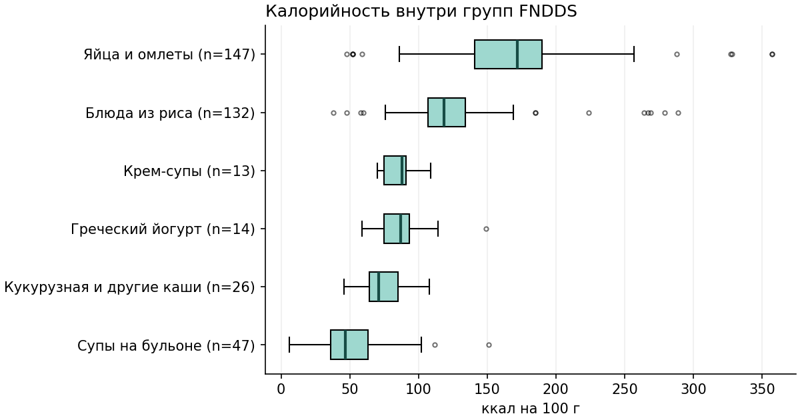
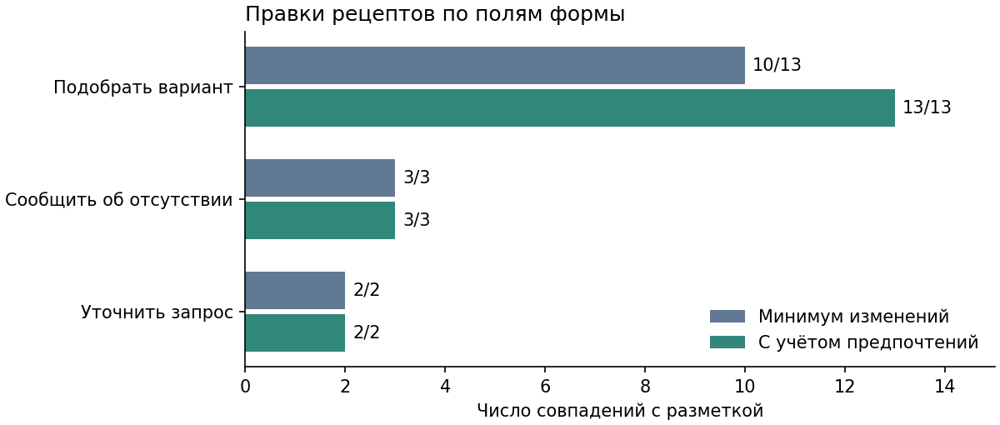

# MealWeek · исследовательский анализ данных

Для подбора недели нужны надёжные значения КБЖУ и рецепты, которые можно менять по просьбе человека. Полноту КБЖУ проверили на полном выпуске USDA. Возможность выбрать правку проверили отдельно на русскоязычных запросах. Единица наблюдения в первом случае — позиция справочника, во втором — просьба изменить конкретное блюдо.

## Какие данные использованы

| Набор | Объём и происхождение | Для чего подходит |
| --- | --- | --- |
| USDA FoodData Central, FNDDS 2021–2023, выпуск октября 2024 | 5 432 позиции из 172 категорий. Это продукты, напитки и блюда, встречавшиеся в американском обследовании питания. Взяли весь выпуск без случайной выборки. | Проверить ключи, КБЖУ на 100 г, массы порций и применимость состава блюда. Каждая позиция имеет одинаковый вес в анализе. Частота потребления и спрос в России по нему неизвестны. |
| Карточки MealWeek | 4 авторские заготовки, 12 связанных с USDA ингредиентов, 10 вариантов вкуса. Для каждого заданы граммы на порцию. | Проверить выбор варианта и пересчёт. Вкус размечен автором, кулинарной проверки и независимой дегустации ещё не было. |
| Просьбы о правке | 18 авторских запросов в 7 семействах. В каждой записи есть текст, явно указанные условия формы и перечень допустимых исходов. Реальных пользователей в выборке нет. | Проверить поведение при выборе варианта, запретах, отсутствии варианта и необходимости уточнить запрос. |

Данные USDA распространяются под CC0. Для воспроизведения в скрипте зафиксированы URL выпуска за октябрь 2024 года и его SHA-256. [Исходный ZIP на сайте USDA](https://fdc.nal.usda.gov/fdc-datasets/FoodData_Central_survey_food_csv_2024-10-31.zip) · [Описание FNDDS](https://fdc.nal.usda.gov/data-documentation/) · [Условия использования](https://fdc.nal.usda.gov/api-guide/#licensing).

## Можно ли считать дневные КБЖУ?

| Проверка полного выпуска | Результат | Решение для MealWeek |
| --- | ---: | --- |
| Уникальность и связи | 0 повторов идентификатора позиции, 0 повторов пары «позиция — нутриент» в 353 015 строках. У всех строк нутриентов, порций и состава есть родительская позиция. | Связывать таблицы по идентификаторам с учётом версии выпуска. Названия использовать для показа и поиска. |
| Все четыре значения на 100 г | 5 431 / 5 432 (99,98%). У записи `2705383` «Milk, human» нет полного КБЖУ. | Пропуск блокирует использование карточки для расчёта. В полных записях 28 значений энергии равны нулю, отрицательных КБЖУ не найдено. Ноль сохраняем как значение источника. |
| Порции | 22 046 строк. У 5 326 описание «Quantity not specified». У одной из них масса 0 г. У 5 395 из 5 432 позиций есть положительная масса и непустое описание порции, отличное от этой пометки. | Принимать в расчёт массу в граммах. Для единиц вроде «чашки» проверять описание и массу для конкретного продукта. Даже положительный вес при неизвестной порции не даёт пользователю понятной меры. |
| Разбор состава | 18 584 строки для 5 431 позиции, у 3 829 позиций несколько составляющих. Во всех строках пусто поле `fdc_of_input_food`, но есть `sr_code` и положительный вес. У 1 125 строк отсутствует единица в исходном поле `unit`. | Нельзя соединить состав с `food.fdc_id` через пустое поле. Для импорта нужен подтверждённый переход от SR-кода к карточке ингредиента. Сам список ингредиентов не содержит последовательность готовки, выход и допустимые изменения. |

В этом CSV четыре нутриента кодируются в `food_nutrient.nutrient_id` числами 208, 203, 204, 205. Им соответствуют строки **по полю `nutrient.nutrient_nbr`** и единицы ккал, г, г, г. Соединение с `nutrient.id` потеряло бы значения. Для углеводов использовали `Carbohydrate, by difference`, как предусмотрено в §1.4 дизайн-дока.



Из 172 категорий выбрали шесть, близких к завтракам и основным блюдам MealWeek. Черта внутри коробки — медиана, края — 25-й и 75-й процентили, точки за усами — наблюдения дальше 1,5 межквартильных размахов от коробки. Среди 132 блюд из риса середина распределения лежит между 107 и 134 ккал на 100 г, но весь диапазон — 38–289. Для супов на бульоне медиана 47, для крем-супов — 88. Подстановка среднего «для риса» или «для супа» может изменить решение о попадании дня в допуск. Нужны состав и вес конкретного варианта.

По всему выпуску медиана равна 167 ккал на 100 г, крайние значения — 0 и 902. Среди нулевых есть кофе без добавок, верхнее значение относится к топлёному свиному жиру. Правило «удалить все крайние значения» выбросило бы допустимые продукты.

## Какие просьбы закрывает форма?

В 18 записях нет повторов ID и дословных повторов запроса. У 5 просьб есть строгое исключение ингредиента, у 3 — мягкое предпочтение по составу. Для 3 запросов допустимо несколько ответов. Все 12 ингредиентов учебных карточек связаны с полным набором КБЖУ. Тесты являются одношаговыми и охватывают только изменение вкуса.

Оба правила получают только поля формы. В исходном тексте и в каталоге варианты остаются доступными для ручной проверки. Запись `gold` задаёт один или несколько приемлемых ответов и читается только при оценке. Желаемый вкус и его интенсивность фильтруют варианты, исключения проверяются по **итоговому** составу. Если не указаны блюдо или вкус, правило запрашивает уточнение. Если в этом каталоге нет допустимой правки, возвращает `unavailable`. [Карточки и варианты](../../datasets/edits/catalog.json) · [Запросы и разметка](../../datasets/edits/cases.jsonl).

| Ожидаемый исход | Число запросов | Минимальное изменение веса | Сначала учесть заявленные предпочтения |
| --- | ---: | ---: | ---: |
| Выбрать один из допустимых вариантов | 13 | 10/13 | 13/13 |
| Сообщить, что вариант отсутствует | 3 | 3/3 | 3/3 |
| Запросить уточнение | 2 | 2/2 | 2/2 |
| **Всего совпало с разметкой** | **18** | **15/18** | **18/18** |



Первое правило выбирает минимальную сумму изменений в граммах. Для овсянки оно предпочло 3 г сахара дополнительным 20 г банана, хотя пользователь предпочитал банан (O3). Для йогурта оно добавило новый фрукт при просьбе сохранить состав (Y3). Для риса оно выбрало вариант без предпочитаемого чеснока (R2). Второе правило сначала учитывает желаемые ингредиенты и просьбу сохранить состав, затем минимизирует изменение веса. Оно исправило все три случая без обращения к LLM. Для будущего сравнения берём второе правило.

При запросе O2 «послаще, без добавленного сахара» оба правила выбрали увеличение банана с 40 до 60 г. Калорийность одной порции выросла с 174,8 до 194,2 ккал, белок — с 4,816 до 4,964 г, жир — с 2,712 до 2,768 г, углеводы — с 35,384 до 39,926 г. При готовке четырёх порций потребуется ещё 80 г банана. Если человек планирует съесть одну порцию, в дневном плане прибавится 19,4 ккал.

Проверили ту же правку на трёх вымышленных днях с разными суммами остальных приёмов пищи. У всех трёх заданы одинаковые тестовые цели: 2 000 ккал, Б 100 г, Ж 72 г, У 240 г. При допусках §1.2 верхние границы — 2 100 ккал и 264 г углеводов. Исходное меню во всех трёх случаях укладывается по каждому показателю. [Исходные суммы и допуски](../../datasets/edits/days.json).

| Запас до правки | Энергия дня до → после, ккал | Углеводы дня до → после, г | Что можно показать пользователю |
| --- | ---: | ---: | --- |
| Запас по всем целям | 2 024,8 → 2 044,2 | 239,384 → 243,926 | Правку можно предложить к подтверждению. |
| Мало запаса по энергии | 2 089,8 → 2 109,2 | 239,384 → 243,926 | Лимит превышен на 9,2 ккал. Нужен другой вариант или согласование изменения дня. |
| Мало запаса по углеводам | 2 024,8 → 2 044,2 | 261,384 → 265,926 | Энергия в допуске, углеводы выше границы на 1,926 г. Правку нельзя подтвердить в таком виде. |

Так у одного и того же ответа «добавить банан» получается один допустимый и два недопустимых дневных плана. Поэтому метрики выбора варианта и проверки итогового дня в §2.3 считаются отдельно. Эти три пограничных случая подобраны вручную для проверки логики.

Все 18 запросов составлены при известном каталоге. У одного семейства общие правила и близкие формулировки. Автор разметки и разработчик правил один, а поля формы уже заполнены вручную. Результат 18/18 показывает, что явные предпочтения реализуемы правилами. Качество понимания свободного текста, удобство для пользователя и выигрыш во времени предстоит измерить отдельно. Из этого набора нельзя вывести частоты запросов, качество всей недели или преимущество агента.

## Воспроизведение

Из корня репозитория, Python 3.12 и `uv`:

```bash
uv sync --locked --group eda
uv run --locked --group eda python scripts/mealweek_eda.py
```

При первом запуске скрипт скачивает архив USDA (3,3 МБ), проверяет SHA-256 и сохраняет его в `data/usda/`. Эта папка исключена из Git. Повторный запуск использует проверенную копию без доступа к сети. По архиву и учебным сценариям скрипт строит обе диаграммы и сохраняет [численные результаты с ответами по каждому запросу](results.json). [Код анализа](../../scripts/mealweek_eda.py) · [Как результаты повлияли на проектирование](../../docs/ml_system_design_doc.md#23-этапы-решения-задачи).
